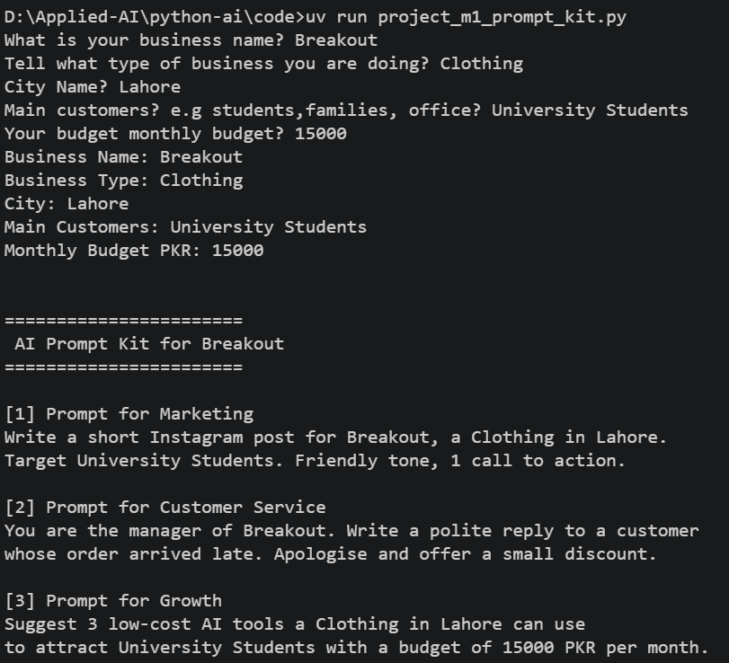

Name : Muhammad Shahzaib
Goal: I want to become an AI Engineer

How to run:
first install libraries that uses in this project currenlty we are not using any library simply we type
uv run main.py this will run main.py file code

To run code file:
First move to code folder
cd /code
then 
uv run lesson_01_intro.py

List of lessons

lesson_01_intro.py
lesson_02_toolkit.py
ollama_first_chat.md
setup-check.png

## Module 1 Project: AI Prompt Kit

A Python tool that turns a local business's details into 3 ready-to-use AI prompts.

**Run:** `uv run code/project_m1_prompt_kit.py`

**Who would pay for this:** 
Small business owner
